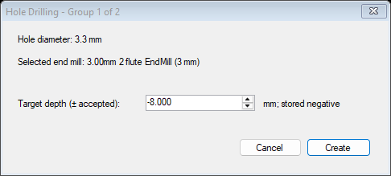

# Hole Drilling for CamBam 1.0 x64

Version: **0.1.0**

This separate plugin creates spiral-milling Drill MOPs from selected hole circles.

## Workflow

1. Select the circles representing the holes to create. Non-circle entities are ignored.
2. Choose **Plugins > Hole Drilling...**.
3. Circles within 0.05 mm (0.002 in) of the same diameter are grouped. For each group, the plugin prompts for a target depth and reports the selected end mill.
4. The plugin creates one Drill MOP per diameter group. It uses Spiral Mill clockwise mode, sets the requested hole diameter, and assigns the largest regular EndMill in the active Part tool library (or the unit-specific default library) that is smaller than the hole.
5. Positive or negative depth input is accepted and stored as a negative target depth. All groups are collected before operations are created, so canceling a prompt creates no MOPs.

Review the spiral depth increment, feeds and speeds, clearance plane, selected tool, and generated toolpath before machining. A tool must be strictly smaller than the hole diameter to leave room for the spiral path. Single-profile thread mills are excluded from the end-mill search.

## Screenshot

For the 3.3 mm bore shown here, the plugin chooses the largest smaller EndMill in the active library: a 3.00 mm cutter. The target depth accepts either sign and is stored negative.

## Install

Close CamBam and run `Install-HoleDrilling.cmd`; approve the Windows administrator prompt. The installer copies `HoleDrilling.dll` to:

`C:\Program Files\CamBam plus 1.0\plugins`

Restart CamBam and find **Hole Drilling...** in the Plugins menu.

## Build

Run `Build-HoleDrilling.cmd` from this folder. The build expects CamBam 1.0 x64 at `C:\Program Files\CamBam plus 1.0` and the .NET Framework 4 x64 C# compiler. The output is `HoleDrilling.dll`.

The source compiles against the locally installed CamBam 1.0 assemblies. Runtime behavior should be reviewed and simulated in CamBam before machining.
