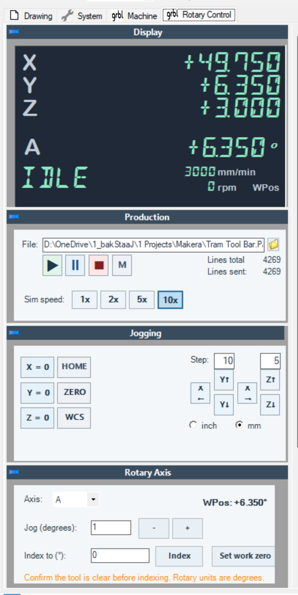
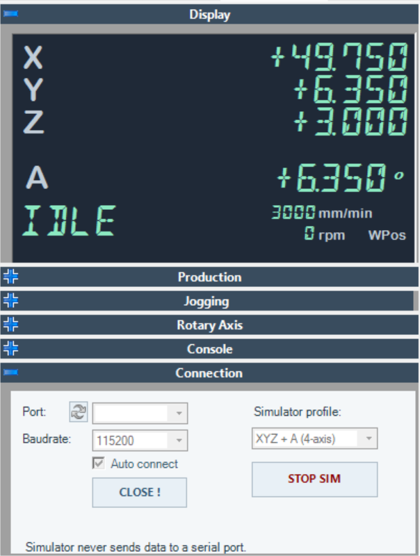
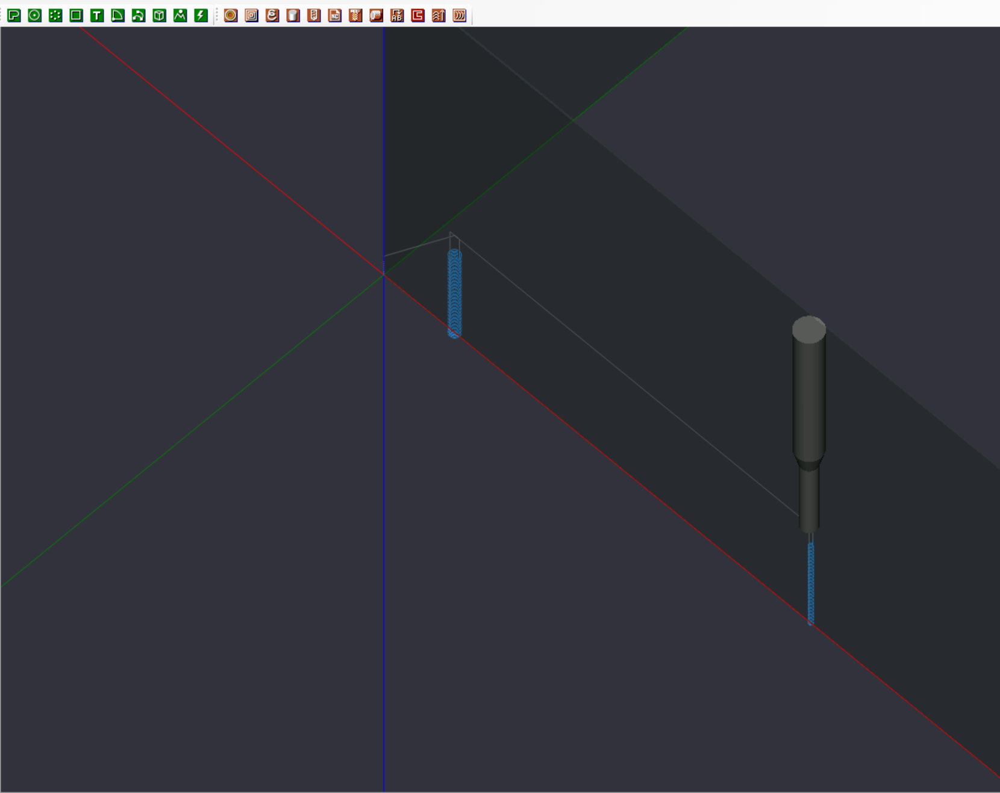

# Rotary Axis Control for CamBam

A new CamBam plugin project based on the locally downloaded GRBL Machine Plugin source. The project will add configurable rotary-axis controls and indexed 4th-axis workflows.

## Provenance and attribution

The initial codebase was derived from **GRBLMachinePlugin** by **KDesign Electronics / Karst Drenth** (2017). The plugin also depends on **CamBam.CAD.Solids** by **KDesign Electronics** (copyright 2017), so the install package includes `CamBam.CAD.Solids.dll`. Original notices are retained in the source and the included helper assembly. The GRBLMachinePlugin developer is credited in the plugin's About panel; both components are credited here and in the [third-party notices](THIRD-PARTY-NOTICES.txt). This is an independent derivative project with its own name and ongoing development.

## Rotary axis milestone

The plugin adds a selectable A/B/C axis, live rotary position feedback, relative degree jogging, single-angle indexing at a configured feed, and rotary work-zero setting. Commands are enabled only while connected and idle, outside a running job, and after the selected axis appears in controller position reports. The UI reminds the operator to clear the tool before indexing.

The sender also previews a selected NC file directly in the CamBam drawing view without inserting preview geometry into the user's drawing. Rapid moves are gray, cutting moves are blue, and the machine tool marker follows reported motion during playback. Large files are sampled to bound preview size. The current preview covers linear G0/G1 XYZ motion with G20/G21 and G90/G91 modes; arc interpolation and rotary-only path projection remain future work.

This is intended for compatible GRBL-derived firmware that reports and accepts the configured rotary axis. Stock three-axis GRBL does not provide that capability. Wrapped or simultaneous 4-axis CAM/postprocessor support, per-operation indexing, homing, and retract automation remain future work. The test build targets AnyCPU for both 32-bit and 64-bit CamBam hosts. Controller validation has not yet been performed.

The Connection tab now includes a controller simulator with selectable XYZ, XYZ+A, XYZ+A+B, and XYZ+A+B+C reports. It exercises position display, rotary jogging, work-zero setting, index commands, and G-code job playback without opening or writing to a serial port. While the simulator is connected, 1x, 2x, 5x, and 10x speed buttons appear in the Production panel; they are hidden for a live controller. Simulated XYZ and rotary moves interpolate through intermediate positions, and the selected multiplier changes the motion rate immediately, including during a move. The timer cadence scales with the selected speed, using higher Windows timer resolution only while the simulator is active so short moves respond to the speed buttons. Move duration is estimated from programmed feed or a simulated rapid rate, preserving retract-before-traverse order. The simulator reports mm/min and reflects M3/M4/M5 and S-word spindle commands in the status display. This is a visualization aid, not a timing or trajectory model. M6 tool changes are skipped. The simulator does not emulate firmware configuration, limits, homing, alarms, electrical behavior, or real motion.

The plugin panels use a shared slate and light-blue control theme with clearer input fields and flatter, higher-contrast buttons. Play, pause, stop, and zeroing controls retain distinct action colors. The Production panel grows while simulator speed controls are visible so the full speed row stays in view, then returns to its normal height when the simulator disconnects. The DRO uses a dark slate background with mint position values; Idle, Run, and Hold use the same mint, while Alarm remains red. Simulator version text is hidden while the simulator button is active so it cannot overlap the button.

When the controller reports rotary axes, the top display adds one position row for each reported A, B, or C axis and expands vertically to fit them. Rotary positions are shown in degrees and follow the same machine/work coordinate display setting as X/Y/Z. The rotary controls still act on the single axis selected in the Rotary Axis panel.

## Screenshots

These current captures show the slate-and-mint DRO, refreshed controls, and simulator playback UI. The Production panel screenshot shows the expanded panel with speed controls visible in simulator mode.

The connection capture shows the simulator profile and the DRO. The simulator stays disconnected from serial ports.

The drawing view shows the simulated tool position alongside the loaded toolpath preview.

## Build

The solution targets .NET Framework 3.5 and AnyCPU. Build `Plugins.sln` in Release mode with a Visual Studio/MSBuild installation that includes the .NET Framework 3.5 resource-generation tools. The build expects `CamBam.CAD.dll` and `CamBam.Geom.dll` from an installed CamBam copy under `CamBamLibs`; these proprietary CamBam assemblies are not included in source releases.

An installable test package is prepared under `dist/`. See `TESTING.md` for installation and the first low-risk controller checks.
