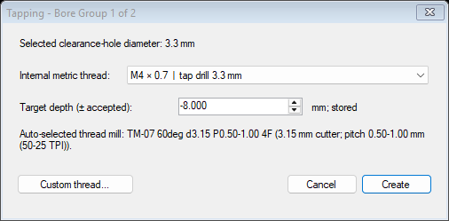

# Tapping for CamBam 1.0 x64

Version: **0.1.0**

This CamBam plugin creates a clearance-drilling MOP and an internal ThreadingMOP from selected bore circles. The selected circle diameter is treated as the drill/bore diameter. The operations are inserted in this order: drilling, then thread milling.

## Workflow

1. In a millimeter or inch drawing, select circles with one or more diameters. Each distinct diameter group must represent a thread clearance/tap-drill size.
2. Choose **Plugins > Tapping...**.
3. For each bore-size group, select a matching metric thread in a millimeter drawing or a UNC thread in an inch drawing, or choose **Custom thread...** and enter its major diameter and pitch in the drawing's units. The plugin shows the supplied thread mill selected from pitch range and bore clearance. Enter a target depth for each group; either sign is accepted and both MOPs store it as a negative depth.
4. After all groups are configured, the plugin inserts a **Clearance Drill** MOP and a **Thread Mill** MOP for each group, using that group's circles. The clearance MOP uses Spiral Mill mode, the requested bore diameter, and the largest regular EndMill smaller than the bore in the active tool library. The Thread Mill MOP is assigned the matched thread cutter from that same library.
5. Review both operations before generating G-code. Check the selected tools, feeds and speeds, spiral depth increment, clearance plane, target depth, and any lead-in/entry choices. Simulate the result and verify the generated code before running the machine.

The list uses metric coarse/fine threads for millimeter drawings and UNC threads for inch drawings. It includes the common metric size range through M64 and UNC sizes from #1 through 2 inches. Each catalog is filtered by the selected hole size and displays its tap-drill size in drawing units. It only shows entries whose nominal tap-drill diameter matches the selected circle within 0.05 mm (0.002 in). Custom threads are not constrained to that list, but the entered major diameter must exceed the bore diameter. Example: a 2.5 mm bore can be paired with a custom M3 x 0.7 thread.

One invocation can handle multiple bore diameters. The plugin groups circles within 0.05 mm (0.002 in) of each other and opens a selector for each group. It collects all choices before creating operations, so canceling any selector creates no MOPs. It creates internal, right-hand threads and configures ThreadingMOP as a single-profile cutter (`ToolFluteLength = 0`). Each group's target depth is assigned to both MOPs. It does not assign tools, feeds, or speeds automatically. Non-circle selected entities are ignored.

The supplied thread mills are recorded in `ThreadMillCatalog.xml` and merged into both `Default-mm.xml` and `Default-in.xml` when installed. The plugin chooses the largest supplied cutter smaller than the bore whose manufacturer-listed pitch range includes the selected pitch. It reports when no supplied cutter fits and will not create an operation pair for that selection. Inch library dimensions are converted from the millimeter cutter specifications. For the clearance operation, it reads the active Part tool library (or the unit-specific default library) and selects the largest positive-diameter `EndMill` smaller than the bore, excluding the single-profile thread mills. The Drill MOP uses Spiral Mill mode so that cutter makes the specified bore diameter. Existing tool indexes are retained; new cutters get unused indexes. The installer keeps a one-time backup beside each default library before modifying it.

## Screenshot

The dialog below shows the thread and depth selection for a 3.3 mm bore. The plugin identifies M4 × 0.7 and reports the matching 3.15 mm thread mill.

## Install

Close CamBam. Run `Install-Tapping.cmd`; approve the Windows administrator prompt. It copies `Tapping.dll` and `ThreadMillCatalog.xml` to:

`C:\Program Files\CamBam plus 1.0\plugins`

It also merges the cutters into any discovered CamBam 1.0 `Default-mm.xml` and `Default-in.xml` under ProgramData or Program Files. The installer is safe to rerun and retains existing tool numbers.

Start CamBam and look under **Plugins** for **Tapping...**. The target installation must include the compatible x64 `ThreadingMOP.dll` plugin.

## Build

Run `Build-Tapping.cmd` from this folder. The build expects CamBam 1.0 x64 at `C:\Program Files\CamBam plus 1.0` and the .NET Framework 4 x64 C# compiler. The output is `Tapping.dll`.

## Compatibility / validation

Built against the local CamBam 1.0 x64 assemblies and installed ThreadingMOP x64 assembly. Compilation succeeded. The plugin has not yet been exercised inside CamBam against a real drawing or machine; validate the generated MOP values and toolpath in CamBam before machining.
